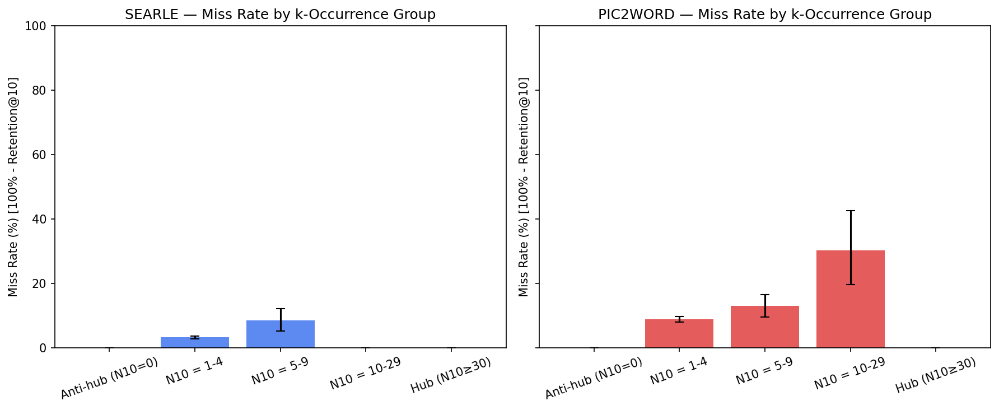
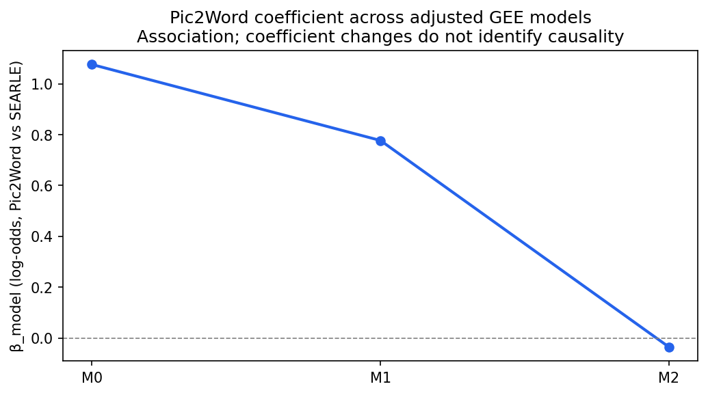
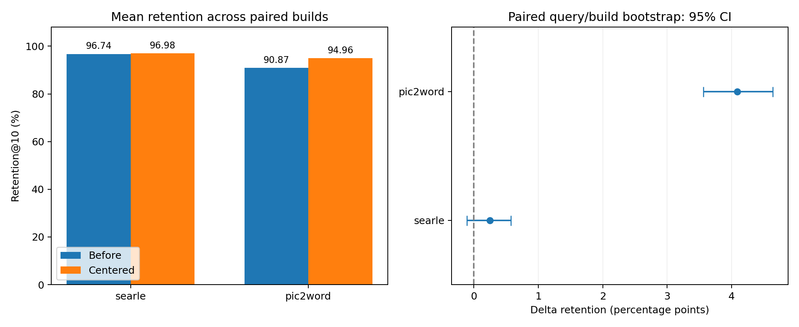

# Báo cáo Thực nghiệm Module A.1: Phân tích Hubness và Recall Retention của HNSW

> Sinh tự động bởi `step5_render_report.py` lúc 2026-10-15T15:19:59.571704Z.
> Mọi số liệu trong báo cáo được đọc từ JSON trong `module_a1_revision/results/`.

---

## 1. Câu hỏi Nghiên cứu

Hiện tượng hubness trong không gian embedding CIRCO có liên quan như thế nào đến xác suất HNSW bỏ sót các láng giềng exact top-10, và liệu các biến hubness/graph có giải thích được khoảng cách retention giữa SEARLE và Pic2Word hay không?

## 2. Giả thuyết & Dự đoán Định lượng

- **H1:** Các neighbor có k-occurrence thấp có tỷ lệ bị HNSW bỏ sót cao hơn các nhóm còn lại.
- **H2:** Khoảng cách retention giữa SEARLE và Pic2Word được giải thích một phần bởi biến hubness/graph.
- **Kế hoạch phân tích:** mô tả miss rate cùng CI bootstrap 95%, kiểm định Wald hai phía các hệ số GEE ở mức 0,05, và theo dõi beta Pic2Word qua M0–M2. Chưa có kiểm định trực tiếp mọi chênh lệch giữa nhóm hoặc ngưỡng cỡ hiệu ứng được đăng ký trước; giảm beta không được dùng làm tiêu chí xác nhận nhân quả hubness.

## 3. Thiết kế Thực nghiệm

- **Dữ liệu & mô hình:** CIRCO, 1020 truy vấn, 123403 ảnh gallery; SEARLE 512-d và Pic2Word 768-d.
- **Đơn vị phân tích:** neighbor-level, tổng cộng 20400 quan sát.
- **Run hiện hành:** profile reference; dataset neighbor-level/hồi quy dùng seed 42; centering báo cáo trung bình 5 cặp lần dựng. Không đồng nhất bảng một seed với trung bình nhiều seed.
- **Phần cứng/thực thi:** Intel64 Family 6 Model 186 Stepping 2, GenuineIntel; FAISS threads=8. Config hash: `7f6fbbcab59d72934e0e3a917f077091d09f5c23e8323346ff06906119887817`.
- **Truy xuất query:** phần val được đối chiếu vector và thứ tự GT; ID test tái dựng từ thứ tự annotation và vòng lặp extraction, do bundle cũ không chứa ID từng hàng. Đây là hạn chế provenance, không phải kiểm chứng độc lập toàn bộ test embedding.
- **Cấu hình chỉ mục:** HNSWFlat, M=32, efSearch=128, efConstruction=200.
- **Phương pháp đo:** exact FlatIP top-10 làm mốc; HNSW retention là tỷ lệ exact neighbor được tìm lại trong HNSW top-10.
- **Thống kê:** clustered bootstrap 95% CI theo `query_id`; GEE logistic regression với cụm `query_id`.

## 4. Kết quả Thực nghiệm

### 4.1. Tóm tắt Step 1

| Mô hình | Retention@10 | Miss rate | Anti-hub gallery ratio | k-occurrence skewness | In-degree=0 ratio |
|---|---:|---:|---:|---:|---:|
| SEARLE | 96.68% | 3.32% | 93.25% | 6.7992 | 0.0049% |
| Pic2Word | 90.84% | 9.16% | 93.46% | 8.3298 | 0.0113% |

### 4.2. Miss rate theo nhóm k-occurrence

| Nhóm | SEARLE Miss Rate | 95% CI | Pic2Word Miss Rate | 95% CI |
|---|---:|---:|---:|---:|
| Anti-hub (N10=0) | N/A | N/A | N/A | N/A |
| N10 = 1-4 | 3.18% | [2.72%, 3.66%] | 8.85% | [8.01%, 9.72%] |
| N10 = 5-9 | 8.45% | [5.15%, 12.04%] | 12.91% | [9.58%, 16.44%] |
| N10 = 10-29 | 0.00% | [0.00%, 0.00%] † | 30.30% | [19.70%, 42.65%] |
| Hub (N10≥30) | N/A | N/A | N/A | N/A |

Ghi chú: nhóm `N10=0` không có quan sát trong bảng neighbor-level vì một ảnh đã xuất hiện trong exact top-10 thì theo định nghĩa có `N10 >= 1`. Do đó kết quả này không được dùng để khẳng định kiểm định Anti-hub có ý nghĩa thống kê.

**Nhận xét về k-occurrence và hubness:** Nhóm có miss rate thấp nhất trong seed reference hiện hành là searle: N10 = 10-29 (0.00%); pic2word: N10 = 1-4 (8.85%). Đây là nhận xét mô tả của lần dựng đang dùng, không phải quy luật miss rate tăng đơn điệu theo N10. Nhận xét nhóm N10=1–4 thấp hơn cả hai nhóm còn lại trong lần chạy trước phải được kiểm tra lại khi đổi lần dựng; không giữ nguyên lời kết luận nếu bảng mới không còn hỗ trợ.

Ở đây, N10 đo số query mà một ảnh xuất hiện trong exact top-10, phản ánh mức độ phổ biến của ảnh trong kết quả truy hồi (hubness theo tập query), không trực tiếp đo số cạnh đi vào hay khả năng tiếp cận ảnh trong đồ thị HNSW. Kết quả gợi ý mối liên hệ giữa mức độ phổ biến này và tỷ lệ bỏ sót trên từng lần xuất hiện, nhưng chưa xác lập quan hệ nhân quả giữa hubness và miss rate. Bảng phân nhóm chưa tách ảnh hưởng của thứ hạng, độ khó query và cấu trúc đồ thị; đồng thời không có quan sát ở các nhóm `N10 = 0` và `N10 ≥ 30`, nên chưa thể khái quát sang anti-hub hoặc hub cực trị.


#### 4.2.1. Cỡ mẫu theo N10

| Model | Nhóm N10 | Dòng neighbor | Query | Neighbor duy nhất | Miss |
|---|---|---:|---:|---:|---:|
| searle | N10 = 1-4 | 9893 | 1020 | 8278 | 315 |
| searle | N10 = 5-9 | 284 | 192 | 47 | 24 |
| searle | N10 = 10-29 | 23 | 23 | 2 | 0 |
| pic2word | N10 = 1-4 | 9708 | 1020 | 7988 | 859 |
| pic2word | N10 = 5-9 | 426 | 283 | 74 | 55 |
| pic2word | N10 = 10-29 | 66 | 60 | 5 | 20 |

#### 4.2.2. Miss rate theo in-degree HNSW tầng 0

| Model | In-degree | Miss rate | CI 95% | Dòng neighbor | Query | Neighbor duy nhất | Miss |
|---|---|---:|---|---:|---:|---:|---:|
| searle | 0–0 | N/A | N/A | 0 | 0 | 0 | 0 |
| searle | 1–4 | 33.71% | [26.66%, 40.78%] | 175 | 143 | 134 | 59 |
| searle | 5–9 | 8.48% | [6.83%, 10.27%] | 1120 | 640 | 907 | 95 |
| searle | 10–29 | 2.49% | [2.05%, 2.94%] | 6555 | 1020 | 5382 | 163 |
| searle | >=30 | 0.94% | [0.55%, 1.39%] | 2350 | 914 | 1904 | 22 |
| pic2word | 0–0 | N/A | N/A | 0 | 0 | 0 | 0 |
| pic2word | 1–4 | 28.66% | [24.38%, 33.19%] | 499 | 353 | 409 | 143 |
| pic2word | 5–9 | 17.62% | [15.60%, 19.70%] | 1896 | 848 | 1463 | 334 |
| pic2word | 10–29 | 6.80% | [5.96%, 7.66%] | 6129 | 1019 | 4858 | 417 |
| pic2word | >=30 | 2.39% | [1.51%, 3.35%] | 1676 | 805 | 1337 | 40 |

† Khoảng bootstrap suy biến ở biên. Các nhóm không có quan sát được ghi N/A. Bootstrap lấy lại query trong từng nhóm. Nếu mọi quan sát đều không bị bỏ sót (hoặc đều bị bỏ sót), bootstrap thực nghiệm cho CI suy biến [0,0] (hoặc [1,1]); đó là giới hạn của phương pháp ở biên, không phải bảo đảm tỷ lệ thật bằng 0 hay 1. Không dùng CI suy biến để khẳng định độ chính xác cao ở nhóm nhỏ.

### 4.3. Trực quan hóa







### 4.4. Nested logistic regression

| Mô hình | beta_model `is_pic2word` | QIC | Diễn giải thiết kế |
|---|---:|---:|---|
| M0 | 1.0757 | 9220.6909 | Baseline: chỉ có biến model |
| M1 | 0.7770 | 8253.8650 | + rank, log_n10, log_indeg |
| M2 | -0.0352 | 7934.8433 | + s1, c_contrast |

#### 4.4.1. Phần này đang trả lời câu hỏi gì?

Bảng miss rate ở trên chỉ cho biết mô hình nào bỏ sót nhiều hơn. Hồi quy đặt thêm câu hỏi: **nếu xét cả thứ hạng láng giềng, tần suất xuất hiện, kết nối đồ thị và đặc tính query, chênh lệch gắn với tên mô hình còn lớn đến đâu?**

Ở đây có hai nghĩa khác nhau của từ “mô hình”: SEARLE/Pic2Word là mô hình tạo embedding; M0/M1/M2 là ba mô hình thống kê dùng để phân tích lỗi của các embedding đó. Hồi quy này không huấn luyện lại SEARLE, Pic2Word hoặc HNSW.

#### 4.4.2. Một dòng dữ liệu và biến cần dự đoán

Mỗi dòng là một bộ `(model, query_id, neighbor_id)`: một ảnh thuộc exact top-10 của một query, trong không gian embedding của một mô hình. Biến đầu ra là `missed`:

- `missed = 1`: ảnh thuộc exact top-10 nhưng không nằm trong HNSW top-10.
- `missed = 0`: ảnh đó cũng được HNSW trả về trong top-10.

Vì vậy, hồi quy dự đoán **xác suất một exact neighbor bị bỏ sót**, không dự đoán một query thất bại hoàn toàn, không dự đoán ảnh có đúng ngữ nghĩa hay không, và không trực tiếp dự đoán retention của cả query. Trung bình `missed` trên các dòng cho miss rate; retention tương ứng bằng một trừ miss rate.

#### 4.4.3. Logistic regression: từ điểm số đến xác suất

Hồi quy cộng các biến đầu vào sau khi nhân với hệ số để tạo một điểm số `z`, rồi biến đổi điểm số thành xác suất `p` trong khoảng 0–1:

```text
z = beta_0 + beta_1*x_1 + beta_2*x_2 + ...
p = 1 / (1 + exp(-z))
odds = p / (1 - p)
logit(p) = ln(odds) = z
```

`exp` là hàm mũ, `ln` là logarithm tự nhiên. `beta_0` (Intercept) là hằng số nền; các beta còn lại biểu thị thay đổi trên thang **log-odds** khi một biến tăng một đơn vị và các biến còn lại giữ nguyên. Phần mềm ước lượng hệ số từ dữ liệu `missed` và các biến đầu vào; người phân tích không tự chọn dấu hay độ lớn của hệ số.

Ví dụ thuần minh họa, **không phải số liệu thực nghiệm**: nếu xác suất bỏ sót là 20%, odds bằng `0,20 / 0,80 = 0,25`. Nếu odds tăng gấp đôi thành 0,50 thì xác suất mới là `0,50 / (1 + 0,50) = 33,33%`, không phải 40%. Do đó, “odds tăng gấp đôi” khác “xác suất tăng gấp đôi”.

Để đọc hệ số dễ hơn, chuyển thành **odds ratio**, viết tắt OR: `OR = exp(beta)`.

| Hệ số beta | Odds ratio | Ý nghĩa đối với sự kiện bị bỏ sót |
|---|---|---|
| Dương | OR > 1 | Odds bỏ sót cao hơn khi biến tăng, giữ các biến khác cố định |
| Bằng 0 | OR = 1 | Không có thay đổi odds theo biến đó trong mô hình |
| Âm | OR < 1 | Odds bỏ sót thấp hơn khi biến tăng, giữ các biến khác cố định |

Hệ số không phải phần trăm miss rate. Chẳng hạn, beta bằng 0,9 không có nghĩa miss rate tăng 90 điểm phần trăm. Cũng không thể so trực tiếp độ lớn beta của hai biến khác đơn vị để kết luận biến nào “quan trọng hơn”.

#### 4.4.4. “Nested” nghĩa là thêm dần biến vào cùng một bài toán

Các mô hình được gọi là **lồng nhau** vì tập biến của mô hình trước là tập con của mô hình sau. Chúng cùng dự đoán `missed` trên cùng tập dữ liệu:

```text
M0: chỉ biết ảnh đến từ SEARLE hay Pic2Word
  -> M1: thêm thứ hạng + k-occurrence + in-degree HNSW
    -> M2: thêm điểm tương đồng cao nhất + độ chênh điểm của query
```

Viết chính xác theo mã nguồn:

```text
M0: logit(p) = b0 + b_model*is_pic2word
M1: logit(p) = b0 + b_model*is_pic2word
              + b_rank*rank + b_n10*ln(1 + N10) + b_indeg*ln(1 + in_degree)
M2: logit(p) = b0 + b_model*is_pic2word
              + b_rank*rank + b_n10*ln(1 + N10) + b_indeg*ln(1 + in_degree)
              + b_s1*s1 + b_contrast*c_contrast
```

**Toàn bộ hệ số được ước lượng lại ở mỗi bước.** M1 không giữ nguyên hệ số đã tính ở M0; M2 cũng không giữ nguyên hệ số của M1. “Nested” ở đây nói về tập biến, không phải một mạng neural nhiều tầng hay một mô hình hiệu ứng ngẫu nhiên phân cấp.

| Biến trong code | Định nghĩa và cách đọc |
|---|---|
| `is_pic2word` | 1 nếu là Pic2Word, 0 nếu là SEARLE. SEARLE là nhóm tham chiếu. Hệ số của biến này so sánh Pic2Word với SEARLE. |
| `rank` | Thứ hạng của ảnh trong exact top-10, từ 1 đến 10. Tăng một đơn vị là lùi một hạng, ví dụ từ hạng 3 xuống hạng 4. |
| `log_n10` | `ln(1 + N10)`, trong đó N10 là số query có ảnh này trong exact top-10. Đây là tần suất theo query, không phải bậc đồ thị HNSW. |
| `log_indeg` | `ln(1 + in_degree_hnsw)`, với in-degree là số cạnh đi vào ảnh ở tầng 0 của HNSW. |
| `s1` | Điểm inner product của ảnh đứng đầu kết quả exact đối với query. Đây là đặc tính của query, không phải điểm riêng của từng neighbor. |
| `c_contrast` | `s1 - s100`, chênh lệch điểm exact giữa ảnh hạng 1 và hạng 100. Đây không phải khoảng cách điểm giữa hạng 10 và 11, và không mặc nhiên đồng nhất với định nghĩa Relative Contrast ở module khác. |

Biến đổi `ln(1 + x)` nén các giá trị đếm lớn và tính được cả khi x bằng 0. Một đơn vị tăng của `log_n10` **không phải** thêm một lần xuất hiện. Khi N10 chuyển từ a sang b, OR là `exp(beta_n10 * ln((1+b)/(1+a)))`. Tương tự cho in-degree.

#### 4.4.5. Vì sao dùng GEE và gom cụm theo query?

Các neighbor của cùng một query có chung điều kiện tìm kiếm nên có thể cùng dễ hoặc cùng khó bị bỏ sót. Nếu coi tất cả các dòng là các phép đo độc lập, mức độ chắc chắn của kết quả có thể bị đánh giá quá cao.

Mã nguồn dùng **GEE (Generalized Estimating Equations)** với phân phối Binomial, liên kết logit, `groups="query_id"` và cấu trúc tương quan làm việc `Independence`. GEE vẫn mô hình hóa xác suất bằng công thức logistic ở trên, nhưng dùng sai số chuẩn robust theo cụm để phục vụ suy luận. `Independence` là lựa chọn cấu trúc làm việc, không có nghĩa sai số chuẩn robust bắt buộc mọi dòng trong query phải độc lập. Xem [tài liệu GEE của statsmodels](https://www.statsmodels.org/stable/gee.html).

Do dữ liệu hai mô hình được gộp chung và nhóm bằng `query_id`, các dòng cùng mã query của cả SEARLE và Pic2Word được gom vào cùng một cụm. Cách này đòi hỏi mã query giữa hai mô hình phải cùng chỉ một truy vấn. Nó xử lý phụ thuộc trong query, nhưng không tự động xử lý mọi phụ thuộc giữa các query khác nhau do cùng truy hồi một ảnh hoặc cùng dùng chung đồ thị.

#### 4.4.6. Đọc beta, khoảng tin cậy và p-value

Trong JSON, `coef` là hệ số beta ước lượng; `std_err` là sai số chuẩn của hệ số; `ci_95_lower/upper` là khoảng tin cậy 95%; `p_value` kiểm định giả thuyết beta bằng 0 trong mô hình đang xét.

- CI của **beta** chứa 0: chưa loại trừ được trường hợp không có liên hệ theo kiểm định hai phía ở mức 5%.
- CI của **OR** chứa 1: cùng ý nghĩa trên, vì `exp(0) = 1`.
- p nhỏ hơn 0,05: có bằng chứng thống kê chống giả thuyết beta bằng 0, trong các giả định của mô hình. Không có nghĩa hiệu ứng lớn hoặc có quan hệ nhân quả.
- p lớn hơn 0,05: chưa đủ bằng chứng bác bỏ beta bằng 0. Không chứng minh beta thực sự bằng 0 hay hai nhóm tương đương.

P-value không phải xác suất giả thuyết không là đúng. CI 95% cũng không có nghĩa 95% số neighbor nằm trong khoảng đó; đây là khoảng bất định của **tham số ước lượng**. CI hồi quy ở phần này dựa trên sai số chuẩn GEE, khác CI bootstrap của miss rate ở mục 4.2.

Bảng dưới lấy beta, CI và p-value trực tiếp từ `step3_nested_logit.json`; OR và CI của OR được tính bằng hàm mũ từ các giá trị đó:

| Mô hình | beta Pic2Word | CI 95% của beta | OR Pic2Word/SEARLE | CI 95% của OR | p-value |
|---|---:|---|---:|---|---:|
| M0 | 1.0757 | [0.9080, 1.2434] | 2.932 | [2.479, 3.467] | 3.03e-36 |
| M1 | 0.7770 | [0.6022, 0.9518] | 2.175 | [1.826, 2.590] | 2.97e-18 |
| M2 | -0.0352 | [-0.2689, 0.1985] | 0.965 | [0.764, 1.220] | 0.768 |

**M0 — chênh lệch chưa điều chỉnh.** Chỉ có tên mô hình làm biến giải thích, nên hệ số phản ánh chênh lệch tổng thể trong mẫu. OR lớn hơn 1 nghĩa là odds bỏ sót của Pic2Word cao hơn SEARLE. Có thể kiểm tra bằng cách đổi điểm số M0 trở lại xác suất:

```text
SEARLE:   z = -3.370343; p = 3.3235%
Pic2Word: z = -3.370343 + 1.075712; p = 9.1569%
```

Các xác suất này khớp miss rate tổng thể sau làm tròn; OR là tỷ số odds, không phải tỷ số trực tiếp của hai miss rate.

**M1 — sau khi thêm rank, N10 và in-degree.** OR của Pic2Word vẫn lớn hơn 1 và CI không chứa 1. Nghĩa là khi điều chỉnh theo ba biến này, chênh lệch gắn với tên mô hình vẫn còn trong mô hình thống kê. Không được gán toàn bộ mức giảm beta cho hubness, vì M1 thêm cả rank và kết nối đồ thị cùng lúc.

**M2 — sau khi thêm s1 và c_contrast.** Hệ số Pic2Word tiến gần 0 hơn, CI của OR chứa 1 và p-value lớn hơn 0,05. Diễn giải phù hợp: sau khi điều chỉnh thêm các đặc tính query này, dữ liệu chưa cho thấy chênh lệch còn lại theo tên mô hình có ý nghĩa thống kê. Không diễn giải thành “SEARLE và Pic2Word bằng nhau” hoặc “đặc tính query đã được chứng minh là nguyên nhân”.

#### 4.4.7. Các biến còn lại trong M2 nói gì?

| Biến | beta M2 | CI 95% của beta | p-value |
|---|---:|---|---:|
| `rank` | 0.0632 | [0.0424, 0.0841] | 2.9e-09 |
| `log_n10` | 0.5732 | [0.4108, 0.7356] | 4.57e-12 |
| `log_indeg` | -1.4419 | [-1.5667, -1.3170] | 1.91e-113 |
| `s1` | -28.1941 | [-32.8095, -23.5786] | 4.94e-33 |
| `c_contrast` | 16.8710 | [11.1700, 22.5721] | 6.63e-09 |

Các dấu trong bảng là **liên hệ có điều kiện**: đọc từng biến khi các biến còn lại được giữ cố định trong mô hình.

- `rank` dương: neighbor ở thứ hạng thấp hơn (số rank lớn hơn) có odds bỏ sót cao hơn.
- `log_n10` dương: tần suất xuất hiện theo query cao hơn gắn với odds bỏ sót cao hơn sau điều chỉnh. Dấu này không ủng hộ dự đoán đơn giản “N10 thấp thì dễ bị bỏ sót hơn”.
- `log_indeg` âm: nhiều cạnh đi vào HNSW hơn gắn với odds bỏ sót thấp hơn. Điều này phù hợp với trực giác về khả năng tiếp cận trên đồ thị, dù chưa chứng minh quan hệ nhân quả.
- `s1` âm: điểm tương đồng cao nhất lớn hơn gắn với odds bỏ sót thấp hơn khi giữ cả c_contrast cố định.
- `c_contrast` dương: khi giữ s1 cố định, c_contrast tăng tương đương s100 giảm. Không thể đọc dấu này thành “query càng rõ ràng thì càng khó” vì đó là một so sánh có điều kiện, và hai biến cùng chứa s1 theo định nghĩa.

Để tránh đọc nhầm thang đo, các OR sau được tính từ hệ số M2; độ tăng là **tình huống minh họa**, không phải một thí nghiệm can thiệp:

- Rank tăng 1: odds nhân với 1.065.
- N10 từ 1 lên 4: odds nhân với 1.691.
- In-degree từ 9 lên 19: odds nhân với 0.368.
- s1 tăng 0,01, giữ c_contrast cố định: odds nhân với 0.754.
- c_contrast tăng 0,01, giữ s1 cố định: odds nhân với 1.184.

Intercept của M2 ứng với mọi biến đầu vào bằng 0, gồm cả rank bằng 0 — nằm ngoài miền rank quan sát. Vì vậy không nên diễn giải riêng Intercept thành miss rate điển hình của SEARLE.

#### 4.4.8. QIC là gì và vì sao giảm lại đáng chú ý?

**QIC (Quasi-likelihood under the Independence model Criterion)** là tiêu chí so sánh mô hình GEE, cân nhắc độ phù hợp với dữ liệu và độ phức tạp. Với cùng dữ liệu và cách tính tương thích, giá trị nhỏ hơn được ưu tiên. Giá trị QIC tuyệt đối không phải phần trăm lỗi; QIC giảm không có nghĩa retention tăng, vì HNSW không được thay đổi khi chạy hồi quy. Xem [tài liệu QIC của statsmodels](https://www.statsmodels.org/v0.11.1/generated/statsmodels.genmod.generalized_estimating_equations.GEE.qic.html).

Trong bảng hiện tại, QIC giảm từ M0 qua M1 đến M2. Điều này ủng hộ việc các biến bổ sung giúp mô tả dữ liệu theo tiêu chí QIC. Nó không thay thế kiểm định một nhóm hệ số, không chứng minh khả năng dự đoán trên dữ liệu mới, và không xác nhận cơ chế nhân quả. Mã hiện tại không báo cáo đánh giá ngoài mẫu hay kiểm định Wald chung cho từng nhóm biến. Không dùng máy móc likelihood-ratio test của logistic maximum likelihood cho các kết quả GEE này.

#### 4.4.9. Có thể kết luận gì từ đường beta M0 → M1 → M2?

**Có thể nói:** hệ số gắn với Pic2Word giảm sau khi bổ sung các biến neighbor/graph và giảm thêm khi bổ sung đặc tính query. Trong M2, N10 và in-degree có liên hệ với lỗi theo hai hướng khác nhau; chênh lệch còn lại theo tên mô hình chưa có ý nghĩa thống kê.

**Chưa thể nói:** “hubness giải thích chính xác bao nhiêu phần trăm chênh lệch” hoặc “query features là nguyên nhân duy nhất”. Ngoài việc thêm nhiều biến cùng lúc, odds ratio trong hồi quy logistic có tính *non-collapsibility*: hệ số trước và sau điều chỉnh có thể khác nhau ngay cả khi không có nhiễu theo nghĩa nhân quả. Vì thế, tỷ lệ giảm beta không tự động là tỷ lệ hiệu ứng được trung gian hóa. Xem [nghiên cứu phương pháp về thay đổi hệ số giữa các mô hình logistic lồng nhau](https://doi.org/10.1177/0081175012444861).

Ngoài ra, các biến như N10, in-degree và điểm tương đồng được đo trong không gian embedding riêng của từng mô hình. “Giữ các biến khác cố định” là cách diễn giải phương trình, không có nghĩa thí nghiệm đã thực sự tạo ra hai hệ embedding giống nhau ở mọi yếu tố còn lại. Cần kiểm tra miền giá trị chồng lấp, dạng hàm, tương tác, độ ổn định giữa các cấu hình và thiết kế can thiệp trước khi suy luận mạnh hơn.

**Câu kết luận dùng cho báo cáo:** “Phân tích GEE logistic với các tập biến lồng nhau cho thấy chênh lệch odds bỏ sót giữa Pic2Word và SEARLE giảm sau điều chỉnh các đặc tính neighbor, đồ thị và query. Kết quả gợi ý vai trò thống kê của các đặc tính này trong việc mô tả chênh lệch, nhưng chưa phân lập đóng góp nhân quả của hubness; việc hệ số mô hình không còn có ý nghĩa thống kê ở M2 không chứng minh hai mô hình tương đương.”


#### 4.4.10. Bảng hệ số đầy đủ M0–M2

| Mô hình | Biến | beta | SE robust | CI 95% | p hai phía |
|---|---|---:|---:|---|---:|
| M0 | Intercept | -3.370343 | 0.078527 | [-3.524252, -3.216433] | 0 |
| M0 | is_pic2word | 1.075712 | 0.085568 | [0.908003, 1.243422] | 3.03e-36 |
| M1 | Intercept | -0.158563 | 0.204016 | [-0.558427, 0.241302] | 0.437 |
| M1 | is_pic2word | 0.776995 | 0.089180 | [0.602205, 0.951785] | 2.97e-18 |
| M1 | rank | 0.061577 | 0.010460 | [0.041076, 0.082078] | 3.94e-09 |
| M1 | log_n10 | 0.438515 | 0.085489 | [0.270961, 0.606070] | 2.9e-07 |
| M1 | log_indeg | -1.429054 | 0.063912 | [-1.554319, -1.303789] | 9.72e-111 |
| M2 | Intercept | 8.668755 | 0.781568 | [7.136910, 10.200600] | 1.38e-28 |
| M2 | is_pic2word | -0.035190 | 0.119250 | [-0.268917, 0.198536] | 0.768 |
| M2 | rank | 0.063242 | 0.010652 | [0.042364, 0.084120] | 2.9e-09 |
| M2 | log_n10 | 0.573188 | 0.082850 | [0.410805, 0.735572] | 4.57e-12 |
| M2 | log_indeg | -1.441894 | 0.063699 | [-1.566741, -1.317046] | 1.91e-113 |
| M2 | s1 | -28.194083 | 2.354859 | [-32.809521, -23.578644] | 4.94e-33 |
| M2 | c_contrast | 16.871027 | 2.908746 | [11.169989, 22.572065] | 6.63e-09 |

p được tính theo kiểm định Wald hai phía của GEE với sandwich SE; giá trị hiển thị 0 nếu xảy ra underflow số học không có nghĩa xác suất toán học đúng bằng 0. Các mô hình đều phải hội tụ trước khi lưu JSON.

### 4.5. Can thiệp centering

Biến thể centering: `subtract_gallery_mean_without_renormalization`.

| Mô hình | Rank invariance | Delta skewness | Delta Retention (điểm phần trăm) | Nhãn nhân quả |
|---|---:|---:|---:|---|
| SEARLE | True | 0.0000 | 0.2490 | inconclusive_for_hubness_causality |
| PIC2WORD | True | 0.0000 | 4.0902 | inconclusive_for_hubness_causality |

#### 4.5.1. Độ ổn định qua các lần dựng và khoảng tin cậy chênh lệch

| Model | Trước (%) | Sau (%) | Delta (điểm %) | CI 95% delta (điểm %) | Các delta theo seed (điểm %) |
|---|---:|---:|---:|---|---|
| searle | 96.7353 | 96.9843 | 0.2490 | [-0.1078, 0.5765] | 0.382, 0.304, 0.078, 0.176, 0.304 |
| pic2word | 90.8745 | 94.9647 | 4.0902 | [3.5647, 4.6413] | 3.951, 3.804, 4.225, 4.039, 4.431 |

CI được tính bằng bootstrap lấy mẫu lại các cặp seed và query, giữ ghép cặp trước–sau. CI phản ánh tập seed và query đang đo; số lần dựng ít, các ảnh được lặp lại giữa query và dùng chung gallery vẫn là giới hạn. Không diễn giải CI này như bằng chứng giảm query-hubness.

| Model | In-degree trung bình trước | Sau | Số query kiểm tra exact rank | Sai số lớn nhất đẳng thức điểm |
|---|---:|---:|---:|---:|
| searle | 21.5223 | 23.3637 | 1020 | 2.98e-07 |
| pic2word | 18.3173 | 25.2703 | 1020 | 2.09e-07 |

Centering gallery không chuẩn hóa lại giữ query và thứ hạng exact: `q·(x−mu) = q·x − q·mu`. Vì vậy N10 theo query được giữ nguyên, nhưng inner product giữa các vector gallery có thể thay đổi và ảnh hưởng xây đồ thị. In-degree/out-degree được đo trực tiếp cho từng seed/biến thể và lưu trong JSON; đây là bằng chứng mô tả thay đổi graph, chưa phân lập đường dẫn nhân quả.

Mức tăng retention là kết quả thực nghiệm có giá trị, ngay cả khi nhãn nhân quả là chưa kết luận. Không so trực tiếp số đo một lần dựng cũ với trung bình nhiều lần dựng mới như một hiệu ứng thuật toán; kết quả trước sửa được lưu tại `R2_Audit/archive/pre_p0_p1_p2b/a1/`.

Dữ liệu từng query: `R2_Audit/module_a1_revision/data/centering_per_query.parquet`. JSON `step4_centering.json` lưu từng seed, thống kê graph, thời gian dựng và các lần đo độ trễ.

## 5. Kết luận & Đánh giá Giả thuyết

- **Trạng thái H1:** **CHƯA KẾT LUẬN**.
- **Trạng thái H2:** **CHƯA KẾT LUẬN**.

**Bằng chứng quyết định từ số liệu:**
- Anti-hub miss rate ở bảng neighbor-level: SEARLE N/A, Pic2Word N/A; hai giá trị là N/A do không có quan sát `N10=0` trong exact top-10.
- beta_model qua M0 -> M1 -> M2: 1.0757 -> 0.7770 -> -0.0352.

Phân tích hiện tại chưa xác nhận H1 trên toàn bộ phổ anti-hub/hub; các nhóm quan sát và hệ số N10 phải được đọc theo đúng đơn vị query→gallery. H2 chưa được nhận diện nhân quả: giảm hệ số trong hồi quy logistic không tự động đo phần đóng góp của hubness. Centering được đánh giá riêng bằng mức tăng retention và CI, không yêu cầu query-N10 phải giảm.

## 6. Hạn chế Thực nghiệm

- Phân tích dùng một gallery CIRCO gồm 123403 ảnh và một cấu hình HNSW tham chiếu.
- GEE không tương đương hồi quy logistic likelihood chuẩn; QIC được dùng khi thư viện hỗ trợ.
- Bootstrap/GEE theo query chưa xử lý mọi phụ thuộc giữa các query cùng truy hồi một ảnh. Hồi quy dùng một seed reference; độ bền hệ số qua các seed chưa được khẳng định.
- HNSW dựng đa luồng có thể không tái lập từng bit ngay cả khi cùng seed; cần đọc phân phối kết quả qua các lần dựng.
- Can thiệp centering giữ thứ hạng exact bằng cách không re-normalize gallery sau khi trừ mean; kết quả có thể khác nếu thay đổi metric hoặc chuẩn hóa.

## 7. Các bước Tiếp theo

1. Chạy thêm cấu hình stress-test HNSW `M=16`, `efSearch=32` để kiểm tra độ bền.
2. Kiểm tra độ nhạy theo neighbor ID và nhiều seed cho các hệ số hồi quy, trước khi đưa ra kết luận cơ chế mạnh hơn.
3. Tiếp tục P2a/P2c theo kế hoạch chung; không coi A.1 hoàn tất là đã hoàn tất Stage A.
