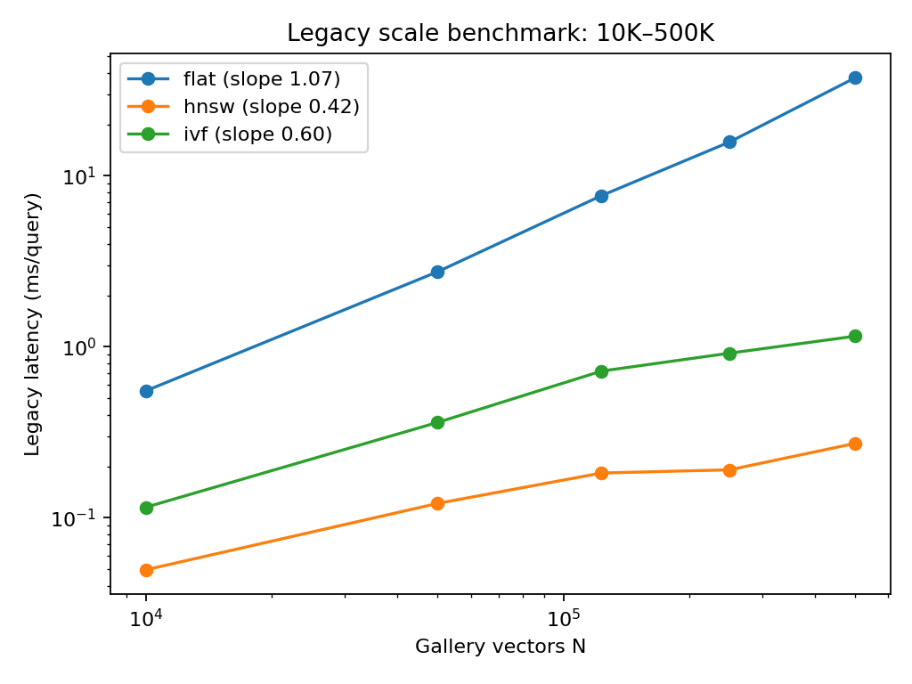

# Báo cáo Thực nghiệm Module A.4: Quy mô gallery 10K–500K

> Bản sửa P0; sinh từ JSON legacy bằng `render_p0_reports.py`. Không gán cấu hình reference mới cho số liệu lịch sử.

## 1. Câu hỏi nghiên cứu

Độ trễ và retention thay đổi thế nào theo kích thước gallery trong benchmark đã lưu?

## 2. Giả thuyết và dự đoán

Phân tích mô tả legacy; chưa xác nhận giả thuyết độ khó truy hồi ảnh thật tăng theo quy mô.

## 3. Thiết kế thực nghiệm

Nguồn: `data/results/phase2_stageA/json/module_a4_scale_benchmark.json`. JSON chưa ghi provenance distractor/hardware. Code cũ dùng HNSW M=32, efSearch=64 và một lần đo; không phải giao thức reference mới. Không gán các tham số suy từ code thành metadata đã xác minh của lần chạy cũ.

## 4. Kết quả

| N | Flat ms | HNSW ms | Speedup | HNSW retention | IVF ms | IVF retention |
|---|---|---|---|---|---|---|
| 10000 | 0.553 | 0.050 | 11.13 | 97.32% | 0.115 | 98.23% |
| 50000 | 2.751 | 0.122 | 22.64 | 95.55% | 0.362 | 97.32% |
| 123403 | 7.665 | 0.183 | 41.89 | 93.64% | 0.722 | 95.95% |
| 250000 | 15.773 | 0.191 | 82.57 | 92.91% | 0.919 | 95.27% |
| 500000 | 37.466 | 0.273 | 137.44 | 93.14% | 1.155 | 93.91% |

Dải đã đo 10,000–500,000; speedup HNSW ở hai đầu 11.13× và 137.44×.

flat: slope log–log=1.0719; hnsw: slope log–log=0.4219; ivf: slope log–log=0.6041. Đây là khớp thực nghiệm trên dải hữu hạn, không phải chứng minh độ phức tạp tiệm cận.

## 5. Kết luận và trạng thái

**ỦNG HỘ MỘT PHẦN:** có tăng tốc trên dữ liệu đã lưu. **CHƯA KẾT LUẬN** cho gallery ảnh thật mở rộng hoặc speedup ở cùng chất lượng.

## 6. Hạn chế

Distractor chưa có provenance được xác minh; code có nhánh Gaussian. Ở 500K, các cấu hình trong bảng chưa đạt retention 95%. Chưa có mAP theo N, CI độ trễ hoặc 7 lần đo. Không so trực tiếp độ trễ khác máy/threads/batch với ICRCV.

## 7. Các bước tiếp theo

P3a: kiểm kê nguồn ảnh/encoder, đo distractor top-10, near-duplicates và mAP; tune tới retention ≥95% rồi đo latency chuẩn. Chưa mở rộng 1M.

### Cập nhật P1 — profile chuẩn hóa

1 warm-up, 7 lần đo, batch query=1, cùng số luồng; JSON lưu từng lần đo. Chênh lệch với legacy/ICRCV chưa thể quy về một nguyên nhân vì metadata lịch sử thiếu. Không tái xác nhận chuỗi 250K/500K chưa kiểm định distractor.

- pic2word, N=123403: FlatIP median=31.6185 ms/query; HNSW median=1.0358, retention=91.86%; IVF median=0.8904, retention=82.00%. [JSON](../../R2_Audit/p1_reference/results/a4_anchor_pic2word.json).
- searle, N=123403: FlatIP median=21.4981 ms/query; HNSW median=0.8350, retention=96.45%; IVF median=0.4377, retention=87.73%. [JSON](../../R2_Audit/p1_reference/results/a4_anchor_searle.json).
