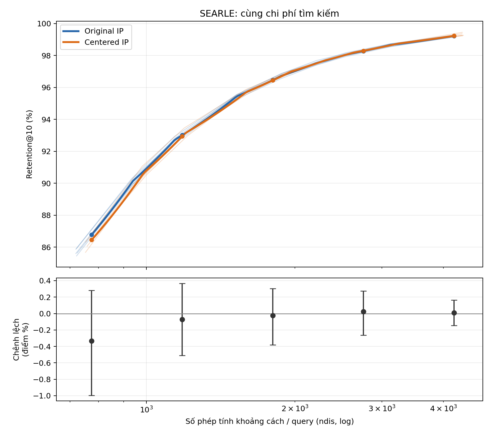
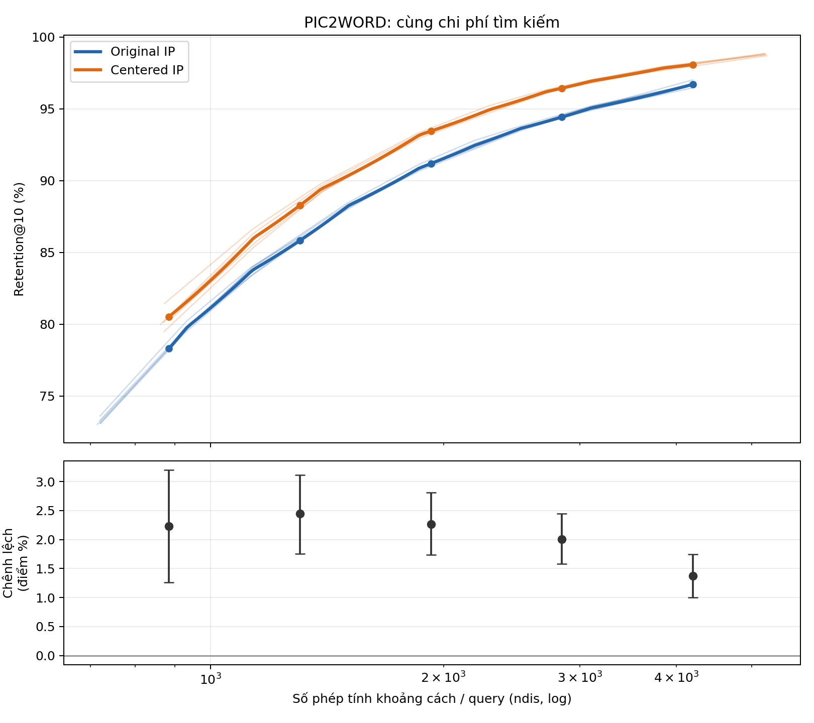

# Báo cáo C1: Centering và retention tại cùng chi phí tìm kiếm

## 1. Câu hỏi nghiên cứu

Centering gallery có tăng retention@10 khi HNSW thực hiện cùng số phép tính khoảng cách trên mỗi truy vấn (`ndis/query`) không? Đối chiếu HNSW gallery gốc với HNSW gallery đã centering, cùng cấu hình dựng; quét `efSearch` để tạo đường đánh đổi giữa chi phí và retention. Đây là phép so sánh hiệu quả tìm kiếm, không phải so sánh tại cùng `efSearch`.

## 2. Giả thuyết và dự đoán đã đăng ký trước

Dự đoán làm việc: lợi thế Pic2Word có thể giảm khi so tại cùng `ndis`, vì đồ thị centered có thể tốn nhiều phép tính hơn ở cùng `efSearch`; hiệu ứng SEARLE có thể nhỏ hơn. Dự đoán và quy tắc đã được ghi trước khi chạy tại [đăng ký trước](../stage0_preregistration.md) và [kế hoạch C1](./ke_hoach_C1.md). CI của chênh lệch centered − original hoàn toàn dương tại một ngân sách hỗ trợ cải thiện ở ngân sách đó; CI chứa 0 nghĩa là chưa đủ bằng chứng về hướng hiệu ứng.

## 3. Thiết kế và cách đo

- Dữ liệu: CIRCO, 123.403 vector gallery và 1.020 query (220 validation, 800 test) cho mỗi backbone: SEARLE 512 chiều và Pic2Word 768 chiều. Query và gallery được chuẩn hóa L2 trước khi biến đổi.
- Original: HNSWFlat inner product trên gallery gốc. Centered: trừ trung bình gallery khỏi mỗi vector gallery, không chuẩn hóa lại; query giữ nguyên. Với mỗi query, điểm IP đổi cùng một hằng số nên exact ranking kỳ vọng không đổi. Exact top-10 được kiểm tra trực tiếp cho toàn bộ query.
- Mỗi model và biến thể dùng 5 seed 42–46, `M=32`, `efConstruction=200`; quét `efSearch = 32, 48, 64, 96, 128, 160, 192, 256, 384`. Retention@10 là tỷ lệ giao giữa top-10 HNSW và top-10 exact của cùng query, sau đó lấy trung bình query.
- `ndis/query` lấy từ `faiss.cvar.hnsw_stats.ndis`, chia số query. Latency là chỉ số phụ: một lượt warm-up, bảy lượt đo, batch 1, trung vị mỗi lượt dựng; phép đo bao gồm overhead Python. Xem [sweep.csv](./sweep.csv) để kiểm tra từng seed, cấu hình và độ trễ.
- So sánh chính: lấy miền `ndis` chung của tất cả các seed original và centered, chọn 5 ngân sách cách đều theo log, nội suy tuyến tính retention từng query/từng seed theo `ndis`, không ngoại suy. Bootstrap percentile 95%, 2.000 lần, lấy mẫu lại đồng thời seed và query theo cặp; `ndis` đo được giữ cố định. CI là tại từng điểm, không phải CI đồng thời.

## 4. Kết quả thực nghiệm

### 4.1. Đường retention–ndis: so sánh chính

Ở mỗi hình, các đường mảnh là từng seed. Hai đường đậm là retention nội suy rồi lấy trung bình tại cùng ngân sách; dấu chấm là năm ngân sách đăng ký trước. Biểu đồ dưới thể hiện trực tiếp chênh lệch centered − original và CI ghép cặp. Chênh lệch dương là centered đạt retention cao hơn tại cùng `ndis`.

#### SEARLE

Miền `ndis` chung: **774.6–4203.3 phép tính/query**.

| ndis/query | Original retention | Centered retention | Chênh lệch (điểm %) | CI 95% (điểm %) |
|---:|---:|---:|---:|---:|
| 774.6 | 86.78% | 86.45% | -0.33 | [-1.00, +0.28] |
| 1182.3 | 93.01% | 92.94% | -0.07 | [-0.51, +0.37] |
| 1804.4 | 96.47% | 96.44% | -0.02 | [-0.38, +0.30] |
| 2754.0 | 98.27% | 98.30% | +0.02 | [-0.26, +0.27] |
| 4203.3 | 99.22% | 99.23% | +0.01 | [-0.15, +0.17] |

Cả năm CI đều chứa 0. Chưa có bằng chứng centering cải thiện retention ở cùng chi phí đối với SEARLE; không diễn giải kết quả này là chứng minh hai phương án hoàn toàn tương đương.

Kiểm tra exact IP: top-10 giống nhau trên 1020 query; sai số lớn nhất của đồng nhất thức dịch điểm là `2.98e-07`.

Độ nhạy nội suy: nếu nội suy retention theo log(`ndis`) thay cho nội suy theo `ndis`, chênh lệch điểm ước lượng thay đổi tối đa **0.079 điểm phần trăm** trên năm ngân sách; đây là phân tích độ nhạy của ước lượng điểm, không phải CI mới.

[Hình bổ sung: original IP, centered IP và centered L2 — searle](./c1_searle_three_variants.png).

#### PIC2WORD

Miền `ndis` chung: **884.2–4199.8 phép tính/query**.

| ndis/query | Original retention | Centered retention | Chênh lệch (điểm %) | CI 95% (điểm %) |
|---:|---:|---:|---:|---:|
| 884.2 | 78.31% | 80.53% | +2.23 | [+1.26, +3.20] |
| 1305.3 | 85.83% | 88.28% | +2.45 | [+1.75, +3.11] |
| 1927.0 | 91.19% | 93.45% | +2.26 | [+1.74, +2.81] |
| 2844.8 | 94.43% | 96.44% | +2.01 | [+1.58, +2.45] |
| 4199.8 | 96.71% | 98.08% | +1.38 | [+1.00, +1.75] |

Tại khoảng **1927 phép tính/query**, original đạt **91.19%**, centered đạt **93.45%**: tăng **2.26 điểm phần trăm**, CI 95% [1.74, 2.81]. Cả năm CI đều dương: dữ liệu ủng hộ cải thiện retention–compute trong vùng khảo sát, dù mức tăng không giống nhau ở mọi ngân sách.

Kiểm tra exact IP: top-10 giống nhau trên 1020 query; sai số lớn nhất của đồng nhất thức dịch điểm là `1.79e-07`.

Độ nhạy nội suy: nếu nội suy retention theo log(`ndis`) thay cho nội suy theo `ndis`, chênh lệch điểm ước lượng thay đổi tối đa **0.105 điểm phần trăm** trên năm ngân sách; đây là phân tích độ nhạy của ước lượng điểm, không phải CI mới.

[Hình bổ sung: original IP, centered IP và centered L2 — pic2word](./c1_pic2word_three_variants.png).

### 4.2. Grid search efSearch và lý do phải khớp chi phí

Bảng sau là trung bình 5 seed tại từng `efSearch` đo được. Đây là số đo trực tiếp, chưa nội suy; cùng hàng không có nghĩa cùng chi phí. Độ trễ là trung bình của trung vị bảy lượt đo theo từng seed, nhằm mô tả chứ không thay thế `ndis` làm tiêu chí chính.

#### SEARLE

| efSearch | Original ndis | Original retention | Original ms/query | Centered ndis | Centered retention | Centered ms/query |
|---:|---:|---:|---:|---:|---:|---:|
| 32 | 721.3 | 85.69% | 0.357 | 761.5 | 86.18% | 0.447 |
| 48 | 939.2 | 90.15% | 0.480 | 988.0 | 90.65% | 0.592 |
| 64 | 1143.4 | 92.74% | 0.498 | 1200.3 | 93.15% | 0.746 |
| 96 | 1524.9 | 95.45% | 0.776 | 1596.3 | 95.72% | 0.955 |
| 128 | 1878.7 | 96.74% | 0.997 | 1960.5 | 96.98% | 1.098 |
| 160 | 2211.4 | 97.53% | 1.202 | 2303.8 | 97.70% | 1.228 |
| 192 | 2527.3 | 98.04% | 1.347 | 2630.2 | 98.18% | 1.386 |
| 256 | 3123.9 | 98.66% | 1.625 | 3246.7 | 98.75% | 1.807 |
| 384 | 4208.9 | 99.23% | 3.248 | 4370.3 | 99.32% | 2.392 |

Ví dụ tại `efSearch=128`, centered dùng 1960.5 so với 1878.7 phép tính/query của original (+4.4%). Vì vậy chênh lệch retention cùng `efSearch` không trả lời trực tiếp câu hỏi cùng chi phí.

#### PIC2WORD

| efSearch | Original ndis | Original retention | Original ms/query | Centered ndis | Centered retention | Centered ms/query |
|---:|---:|---:|---:|---:|---:|---:|
| 32 | 719.3 | 73.23% | 0.262 | 871.9 | 80.26% | 0.259 |
| 48 | 932.5 | 79.79% | 0.339 | 1138.5 | 86.04% | 0.345 |
| 64 | 1133.6 | 83.77% | 0.394 | 1389.7 | 89.42% | 0.426 |
| 96 | 1508.0 | 88.27% | 0.559 | 1863.8 | 93.19% | 0.599 |
| 128 | 1860.9 | 90.87% | 0.687 | 2300.0 | 94.96% | 0.732 |
| 160 | 2192.4 | 92.45% | 0.828 | 2714.5 | 96.20% | 0.879 |
| 192 | 2508.5 | 93.62% | 0.985 | 3107.9 | 96.94% | 1.024 |
| 256 | 3107.2 | 95.06% | 1.210 | 3850.5 | 97.84% | 1.889 |
| 384 | 4204.4 | 96.71% | 1.705 | 5211.4 | 98.78% | 1.813 |

Ví dụ tại `efSearch=128`, centered dùng 2300.0 so với 1860.9 phép tính/query của original (+23.6%). Vì vậy chênh lệch retention cùng `efSearch` không trả lời trực tiếp câu hỏi cùng chi phí.

## 5. Kết luận và đánh giá giả thuyết

**Pic2Word — ỦNG HỘ MỘT PHẦN:** centering cải thiện retention tại cả năm ngân sách chung khảo sát, với CI ghép cặp dương tại từng điểm. Kết quả ủng hộ lợi thế trong cấu hình đã đo; chưa thể khẳng định hiệu ứng phổ quát hoặc tách cơ chế đồ thị dày hơn nếu chưa hoàn thành C2.

**SEARLE — CHƯA KẾT LUẬN:** cả năm CI chứa 0, nên chưa có bằng chứng lợi thế tại cùng chi phí. Dự đoán hiệu ứng nhỏ hơn phù hợp với kết quả mô tả, nhưng so sánh trực tiếp độ lớn hiệu ứng giữa backbone chưa được kiểm định.

## 6. Hạn chế

Chỉ có 5 seed; dựng HNSW đa luồng có thể thay đổi theo lịch luồng. CI coi ndis quan sát được là cố định và không hiệu chỉnh cho nhiều điểm; nội suy là xấp xỉ giữa các `efSearch` đã đo. Latency phụ thuộc máy, thời điểm và overhead. ID nguồn của 800 test query chưa được xác minh từng hàng; ghép cặp trong C1 dựa vào thứ tự feature, không xác nhận ánh xạ ID. Workspace dirty nên provenance dựa vào hash tệp thay vì clean commit. C1 chỉ khảo sát CIRCO và một cấu hình dựng.

Đường centered L2 đã được đo với exact L2 riêng, nhưng chưa thể dùng làm kiểm định bất biến C3: cần thêm L2 gốc và kiểm tra dịch cả query lẫn gallery. Hình bổ sung ba trạng thái biểu diễn trung bình tại cùng efSearch và không chứng minh đối chứng C3.

## 7. Bước tiếp theo

Thực hiện C2: đo số cạnh và so original tăng M với centered ở cùng mật độ và cùng ndis. Thực hiện C3: dựng L2 gốc, kiểm tra bất biến khoảng cách và thứ hạng khi dịch cả hai phía. Sau đó làm C4–C5 trước khi gửi mentor theo cổng đã định.

Dữ liệu và mã: [JSON kết quả](./results.json), [bảng cùng ngân sách](./comparison.csv), [bảng sweep](./sweep.csv), [manifest](./run_manifest.json), [mã phân tích](./analyze_c1.py), [mã tạo báo cáo](./render_c1_report.py), và checkpoint theo seed trong `data/`.
