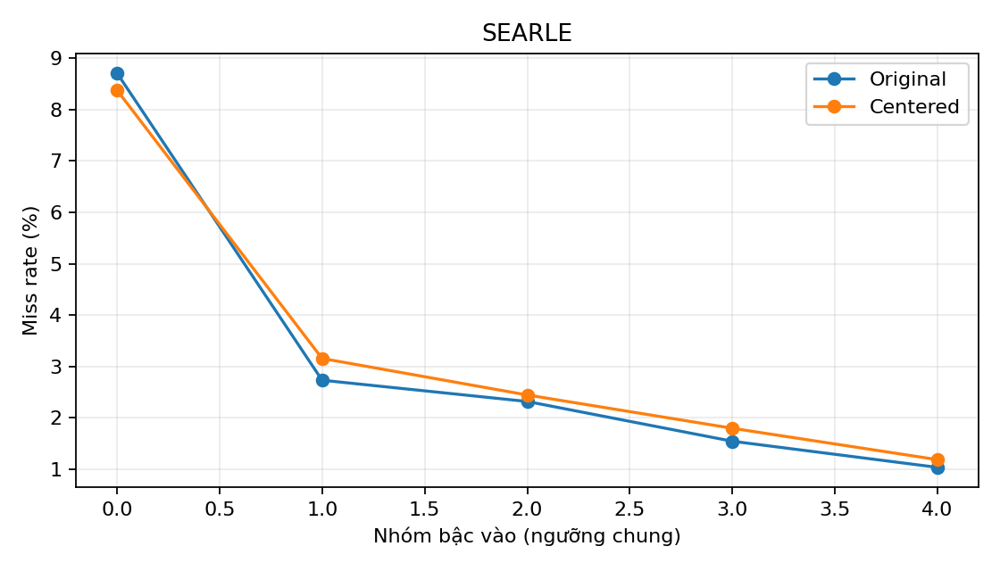
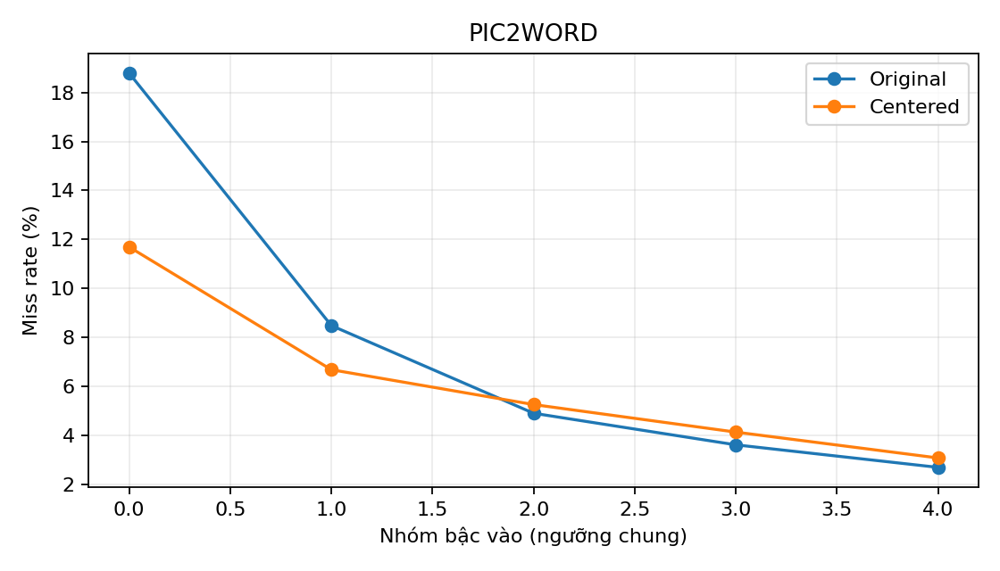

# C4 — Hình học gallery và phân bố bậc vào khi centering

## 1. Câu hỏi nghiên cứu

Centering làm thay đổi MCS, N10 phía gallery, bậc vào HNSW và miss rate của exact neighbor như thế nào? Xem [kế hoạch](./ke_hoach_C4.md).

## 2. Giả thuyết trước khi chạy

Dự đoán Pic2Word có MCS gốc cao hơn SEARLE; không định trước hướng thay đổi N10 hoặc in-degree. Phân biệt chuyển nhóm bậc vào với thay đổi miss trong cùng nhóm; không suy ra quan hệ nhân quả.

## 3. Thiết kế

CIRCO, 123.403 gallery, 1.020 query/model, hai backbone, 5 seed HNSW IP M=32 efConstruction=200 efSearch=128. Dữ liệu đồ thị R2 được tái sử dụng sau kiểm tra chữ ký đầy đủ: in-degree và trạng thái tìm thấy lấy cùng checkpoint. N10 gallery tìm exact IP giữa ảnh gallery, loại self theo ID, k=10; centered không chuẩn hóa lại khi tìm. MCS centered đo cosine trên bản sao đã chuẩn hóa. Bin bậc vào dùng quintile gộp trước/sau, ngưỡng trùng được gộp. Bootstrap ghép seed/query 2.000 lần; xem kế hoạch và manifest.

## 4. Kết quả

### 4.1. Hình học và N10 gallery

| Model | ‖μ‖ gốc | ‖μ‖ centered | MCS gốc | MCS centered | Skew N10 gốc | Skew N10 centered | N10=0 gốc | N10=0 centered |
|---|---:|---:|---:|---:|---:|---:|---:|---:|
| searle | 0.68407 | 4.97e-06 | 0.46795 | 0.00011 | 2.659 | 4.624 | 8.48% | 9.91% |
| pic2word | 0.70335 | 4.74e-06 | 0.49470 | 0.00014 | 2.659 | 3.402 | 10.72% | 5.61% |

### 4.2. Bậc vào và miss rate

Bảng điều kiện theo nhóm trước/sau dùng các tập neighbor có thể khác nhau. Chênh lệch cùng nhóm chỉ xét các occurrence giữ nguyên nhóm, không phải hiệu ứng nhân quả.

#### SEARLE

Ngưỡng nhóm: [1.0, 12.0, 17.0, 23.0, 33.0, 138.0]. Miss toàn bộ: gốc 3.26%, centered 3.02%.

| Nhóm | Dòng gốc/sau | Ảnh khác nhau gốc/sau | Miss gốc/sau | Chênh lệch miss cùng nhóm (điểm %) | CI 95% |
|---:|---:|---:|---:|---:|---:|
| 0 | 10054/7625 | 3533/2899 | 8.71% / 8.38% | +1.18 | [-0.55, +3.06] |
| 1 | 10366/9036 | 4901/4439 | 2.73% / 3.15% | +0.20 | [-1.07, +1.40] |
| 2 | 10579/10605 | 5274/5301 | 2.32% / 2.44% | +0.39 | [-0.72, +1.49] |
| 3 | 10704/12151 | 5288/5718 | 1.54% / 1.79% | +0.59 | [-0.09, +1.36] |
| 4 | 9297/11583 | 4129/4831 | 1.03% / 1.18% | -0.10 | [-0.59, +0.41] |

[Bảng chi tiết và CI theo nhóm](./degree_groups.csv); [bảng chuyển nhóm](./degree_transitions.csv).

#### PIC2WORD

Ngưỡng nhóm: [0.0, 11.0, 17.0, 23.0, 33.0, 131.0]. Miss toàn bộ: gốc 9.13%, centered 5.04%.

| Nhóm | Dòng gốc/sau | Ảnh khác nhau gốc/sau | Miss gốc/sau | Chênh lệch miss cùng nhóm (điểm %) | CI 95% |
|---:|---:|---:|---:|---:|---:|
| 0 | 14145/3464 | 4261/1541 | 18.80% / 11.69% | -3.13 | [-6.18, -0.05] |
| 1 | 12527/9080 | 5380/4056 | 8.48% / 6.67% | -1.09 | [-2.93, +0.62] |
| 2 | 9173/10801 | 4643/5184 | 4.89% / 5.25% | +0.14 | [-1.36, +1.61] |
| 3 | 8408/13409 | 4299/5935 | 3.60% / 4.12% | -0.27 | [-1.34, +0.77] |
| 4 | 6747/14246 | 3192/5299 | 2.68% / 3.07% | -0.61 | [-1.37, +0.09] |

[Bảng chi tiết và CI theo nhóm](./degree_groups.csv); [bảng chuyển nhóm](./degree_transitions.csv).

### 4.3. Phân rã mô tả chênh lệch giữa hai model

**Câu hỏi.** Trên hai đồ thị gốc ở seed 42, các đặc trưng của exact neighbor và query có thể mô tả bao nhiêu chênh lệch miss giữa Pic2Word và SEARLE theo hai mô hình logistic? Phép phân rã này so sánh **hai model trước centering**; nó không phân rã tác động của centering và không chứng minh cơ chế HNSW.

**Đơn vị và mô hình.** Một quan sát là một cặp query–ảnh thuộc exact top-10; biến đích là ảnh đó có bị HNSW bỏ sót hay không. Với mỗi model có 1.020 query × 10 neighbor = 10.200 dòng, từ một đồ thị seed 42. Hai mô hình logistic không điều chuẩn được khớp riêng; các biến được chuẩn hóa bằng trung bình và độ lệch chuẩn của dữ liệu gộp. Nhóm đặc trưng **neighbor** gồm rank, `log1p(in-degree)` và `log1p(N10_gallery)`; nhóm **query** gồm điểm exact `s1` và `s100`.

**Cách đọc phép phân rã.** Gọi `S` và `P` là miss quan sát của SEARLE và Pic2Word; `fS(X)` và `fP(X)` là miss dự đoán trung bình theo hệ số logistic của từng model khi đưa vào bộ đặc trưng `X`. Chênh lệch quan sát `P − S` được viết theo hai cách:

- **Mốc SEARLE:** phần theo đặc trưng `fS(XP) − S`; phần còn lại `P − fS(XP)`. Hình dung: đưa đặc trưng Pic2Word vào mô hình của SEARLE, rồi so dự đoán với miss thực của Pic2Word.
- **Mốc Pic2Word:** phần theo đặc trưng `P − fP(XS)`; phần còn lại `fP(XS) − S`. Hình dung: đưa đặc trưng SEARLE vào mô hình của Pic2Word, rồi so dự đoán với miss thực của SEARLE.

Hai phép tính dùng hệ số tham chiếu khác nhau nên không cần cho cùng một kết quả. Mỗi phần là chênh lệch trên **thang xác suất**, trình bày bằng điểm phần trăm.

| Đại lượng | Ước lượng (điểm %) | CI 95% bootstrap (điểm %) |
|---|---:|---:|
| Chênh lệch miss quan sát: Pic2Word − SEARLE | +5.83 | [+4.83, +6.80] |
| Mốc SEARLE: phần theo đặc trưng | +6.37 | [+4.44, +8.54] |
| Mốc SEARLE: phần còn lại | -0.53 | [-3.11, +1.77] |
| Mốc Pic2Word: phần theo đặc trưng | +5.16 | [+4.31, +6.03] |
| Mốc Pic2Word: phần còn lại | +0.67 | [-0.07, +1.49] |

Theo mốc SEARLE, +6.37 cộng -0.53 xấp xỉ +5.83 điểm % sau làm tròn. Phần theo đặc trưng lớn hơn chênh lệch quan sát vì phần còn lại âm; không diễn giải điều này là đặc trưng gây ra hơn 100% chênh lệch. Hai CI của phần còn lại đều chứa 0, nên dữ liệu chưa xác định rõ dấu của phần này trong hai mô hình.

**Độ nhạy với thứ tự thay nhóm đặc trưng.** Để mô tả phần theo đặc trưng, mô hình tạo một bảng trung gian: thay nhóm neighbor trước rồi nhóm query, hoặc thay nhóm query trước rồi nhóm neighbor. Trong bảng dưới, cột neighbor luôn là đóng góp của nhóm `(rank, in-degree, N10_gallery)` và cột query luôn là đóng góp của `(s1, s100)`, bất kể nhóm nào được thay trước.

| Hệ số tham chiếu | Thứ tự thay | Neighbor (điểm %; CI 95%) | Query (điểm %; CI 95%) |
|---|---|---:|---:|
| SEARLE | Neighbor → query | +1.49 [+1.07, +1.78] | +4.87 [+2.96, +7.17] |
| SEARLE | Query → neighbor | +2.98 [+2.38, +3.81] | +3.39 [+1.88, +4.99] |
| Pic2Word | Neighbor → query | +1.39 [+1.04, +1.65] | +3.77 [+2.87, +4.76] |
| Pic2Word | Query → neighbor | +2.32 [+1.99, +2.78] | +2.84 [+2.09, +3.51] |

Hai thành phần theo từng thứ tự cộng xấp xỉ phần theo đặc trưng của cùng mốc; sai lệch nhỏ có thể xuất hiện do làm tròn và sai số khớp mô hình. Sự thay đổi khi đổi thứ tự cho thấy không có một cách chia duy nhất giữa hai nhóm. Mỗi bảng trung gian ghép đặc trưng theo cùng vị trí hàng query/rank giữa hai model; một hàng lai có thể không mô tả query thực tế. Vì vậy không xem các con số trong bảng là mức miss do riêng một nhóm biến gây ra.

**Độ bất định và hạn chế.** Dùng bootstrap percentile theo query, lấy mẫu query độc lập trong từng model và giữ 10 neighbor của mỗi query; số lần fit thành công 2000/2000. Chỉ có một seed đồ thị cho phân rã này; bootstrap không bao gồm biến thiên giữa seed, không điều chỉnh phụ thuộc do cùng một ảnh xuất hiện trong nhiều query và không điều chỉnh cho nhiều phép so sánh. Kiểm tra khoảng min–max của từng predictor chỉ cho thấy giao nhau theo từng biến, không bảo đảm hai model có vùng hỗ trợ chung theo tổ hợp đặc trưng; không giả định `s1` hoặc `s100` có cùng ý nghĩa hình học giữa backbone. Miền giá trị từng biến và kết quả chi tiết nằm trong [decomposition.json](./decomposition.json).

**Kết luận của mục 4.3:** mô hình cho thấy việc thay phân phối các đặc trưng đi kèm chênh lệch miss dự đoán, nhưng cách chia phụ thuộc hệ số tham chiếu, thứ tự và cách ghép hàng. Đây là phân tích mô tả bổ sung, không phải bằng chứng nhân quả và không phải kết luận chính về cơ chế centering.

## 5. Đánh giá

MCS gốc Pic2Word cao hơn SEARLE trong dữ liệu này. Tham khảo bảng và CI khi đánh giá chuyển nhóm và miss trong nhóm; không suy ra MCS gây ra thay đổi retention từ so sánh hai backbone.

## 6. Hạn chế

Bootstrap query chưa xử lý đầy đủ phụ thuộc do ảnh xuất hiện ở nhiều query; chỉ có năm seed. Decomposition dùng seed 42 và ghép hàng/rank mô tả, nhạy với overlap và mô hình; không dùng làm mediation. ID test theo thứ tự feature chưa được xác minh độc lập từng hàng. C2 chưa khớp mật độ trong 2%; cấu hình reference không kiểm soát ndis khi so miss. Workspace dirty được ghi bằng hash.

## 7. Bước tiếp theo

Đánh giá độ nhạy theo cụm ảnh và vùng overlap trước khi suy luận mạnh; tiếp tục C5 theo kế hoạch.

[Kết quả JSON](./results.json) · [phân rã](./decomposition.json) · [manifest](./run_manifest.json) · [bảng nhóm](./degree_groups.csv) · [bảng chuyển nhóm](./degree_transitions.csv).
