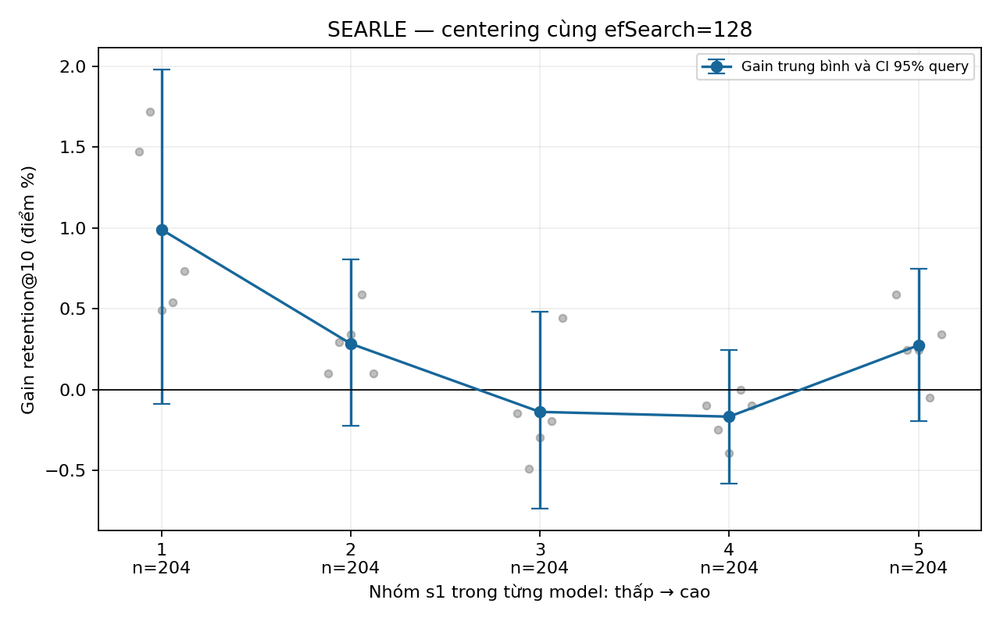
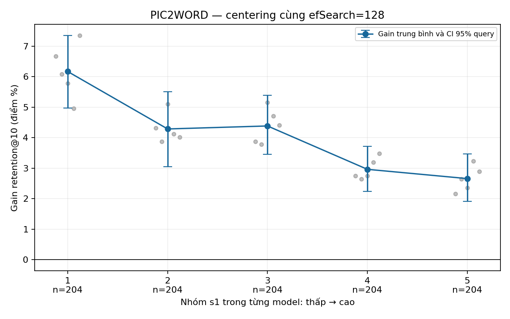

# C5 — Query nào được lợi từ centering?

## 1. Câu hỏi nghiên cứu

Trong từng backbone, query có `s1` thấp có gain retention@10 lớn hơn khi centering gallery không? Gain là retention centered trừ original, trung bình 5 seed.

## 2. Dự đoán trước khi chạy

Dự đoán đăng ký trước: gain cao hơn ở `s1` thấp, giảm đơn điệu từ nhóm thấp đến cao. Quy tắc làm việc: trung bình 5 nhóm không tăng và CI 95% của chênh lệch nhóm thấp nhất − cao nhất hoàn toàn dương. Xem [kế hoạch](./ke_hoach_C5.md) và [đăng ký trước](../stage0_preregistration.md).

## 3. Thiết kế

CIRCO, 1.020 query/model, 5 seed, HNSW IP `M=32`, `efConstruction=200`, `efSearch=128`. Từ exact IP trên gallery gốc, chia query thành quintile `s1` riêng từng backbone; điểm `s1` thấp là độ tương đồng top-1 thấp trong backbone đó. Bootstrap 2.000 lần lấy mẫu query trong nhóm cố định, sau khi trung bình 5 seed; CI độ nhạy bootstrap chéo query và seed. CI theo nhóm không phải CI đồng thời.

Dữ liệu parquet ghép đúng từng query/seed với checkpoint R2, và exact C4 được tính lại để đối chiếu. Validation prefix và thứ tự target đã kiểm tra; 800 test feature rows chưa có ID nguồn xác minh độc lập. Đây là so sánh cùng efSearch, chưa khớp ndis hoặc mật độ.

## 4. Kết quả

### SEARLE

| Nhóm s1 | Khoảng s1 thực tế | Query | Original | Centered | Gain (điểm %) | CI query 95% | CI query + seed 95% |
|---:|---:|---:|---:|---:|---:|---:|---:|
| 1 | 0.28686–0.33364 | 204 | 92.61% | 93.60% | +0.99 | [-0.09, +1.98] | [-0.26, +2.16] |
| 2 | 0.33365–0.34607 | 204 | 97.20% | 97.48% | +0.28 | [-0.23, +0.80] | [-0.33, +0.89] |
| 3 | 0.34609–0.35713 | 204 | 97.59% | 97.45% | -0.14 | [-0.74, +0.48] | [-0.99, +0.61] |
| 4 | 0.35721–0.37008 | 204 | 98.32% | 98.16% | -0.17 | [-0.58, +0.25] | [-0.65, +0.31] |
| 5 | 0.37017–0.44182 | 204 | 97.96% | 98.24% | +0.27 | [-0.20, +0.75] | [-0.29, +0.85] |

Chênh lệch gain nhóm thấp nhất − cao nhất: **+0.72 điểm %**, CI query **[-0.46, +1.83]**, CI độ nhạy query + seed **[-0.57, +1.96]**. Trung bình theo 5 nhóm không tăng: **không**; quy tắc làm việc đã định trước được hỗ trợ: **không**.

### PIC2WORD

| Nhóm s1 | Khoảng s1 thực tế | Query | Original | Centered | Gain (điểm %) | CI query 95% | CI query + seed 95% |
|---:|---:|---:|---:|---:|---:|---:|---:|
| 1 | 0.26763–0.30658 | 204 | 85.60% | 91.76% | +6.17 | [+4.97, +7.35] | [+4.63, +7.74] |
| 2 | 0.30661–0.32033 | 204 | 89.89% | 94.18% | +4.28 | [+3.05, +5.51] | [+2.97, +5.68] |
| 3 | 0.32034–0.33462 | 204 | 91.36% | 95.75% | +4.38 | [+3.45, +5.39] | [+3.24, +5.62] |
| 4 | 0.33472–0.35320 | 204 | 93.15% | 96.11% | +2.96 | [+2.24, +3.72] | [+2.04, +3.89] |
| 5 | 0.35326–0.45867 | 204 | 94.37% | 97.03% | +2.66 | [+1.91, +3.46] | [+1.72, +3.70] |

Chênh lệch gain nhóm thấp nhất − cao nhất: **+3.51 điểm %**, CI query **[+2.10, +4.89]**, CI độ nhạy query + seed **[+1.48, +5.31]**. Trung bình theo 5 nhóm không tăng: **không**; quy tắc làm việc đã định trước được hỗ trợ: **không**.

## 5. Đánh giá dự đoán

**SEARLE — CHƯA KẾT LUẬN: chưa có bằng chứng theo quy tắc đã đăng ký; CI chênh lệch hai nhóm đầu cuối chưa hỗ trợ mức tăng dương.**

**PIC2WORD — ỦNG HỘ MỘT PHẦN: nhóm thấp nhất có gain cao hơn nhóm cao nhất với CI query dương, nhưng chưa đạt quy tắc đơn điệu của cả năm nhóm. Ví dụ gain nhóm 2 là +4.28 điểm % và nhóm 3 là +4.38 điểm %; không khẳng định hai nhóm giữa khác nhau có ý nghĩa thống kê.**

CI của một nhóm không kiểm định sự khác biệt giữa hai nhóm. Kết quả không thỏa quy tắc mô tả không đồng nghĩa bác bỏ mọi quan hệ có thể tồn tại.

## 6. Hạn chế

Cùng efSearch không bảo đảm cùng ndis hay số cạnh. C1 khảo sát cùng ndis ở mức tổng thể; C2 chưa đạt khớp số cạnh. CI chính cố định 5 đồ thị và ngưỡng nhóm; CI độ nhạy chỉ dùng 5 seed. Query có thể phụ thuộc do chia sẻ ảnh; bootstrap query chưa giải quyết đầy đủ phụ thuộc theo ảnh. CI từng điểm không điều chỉnh đồng thời nhiều so sánh. 800 test query ID được tái dựng từ thứ tự extraction, chưa xác minh độc lập theo từng feature row. Điểm s1 giữa hai backbone không nhất thiết cùng thang đo.

## 7. Bước tiếp theo

Xem C5 cùng C1/C2/C4, sau đó kiểm tra H-MG theo kế hoạch R3; không coi tương quan giữa s1 và gain là bằng chứng nhân quả.

[JSON kết quả](./results.json) · [manifest](./run_manifest.json) · [kiểm tra ghép query](./mapping_audit.json) · [dữ liệu từng query](./data/query_gains.parquet).
