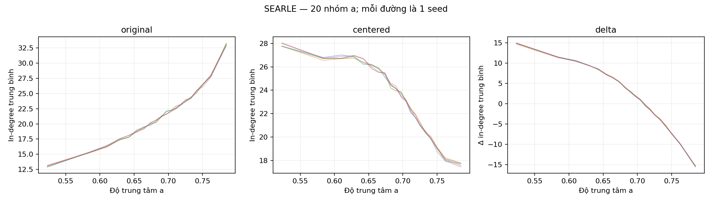
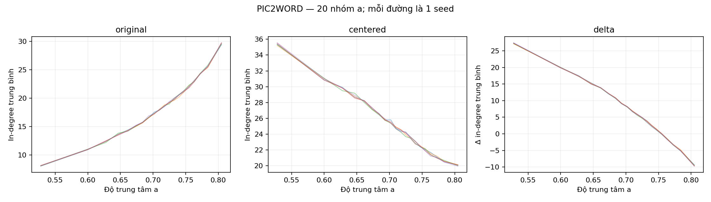

# D1 — Độ trung tâm và bậc vào HNSW

## 1. Câu hỏi và dự đoán

Tương quan giữa độ trung tâm gallery `a` và bậc vào HNSW thay đổi như thế nào sau centering? Dự đoán theo feedback: original dương, centered âm và chênh lệch bậc vào centered − original âm. [Đăng ký phân tích](./dang_ky_truoc.md) được ghi sau khi đã biết R3, trước khi tính D1.

## 2. Thiết kế

CIRCO: 123.403 ảnh/model, hai backbone, HNSW IP M=32, 5 seed. Tính Spearman midrank trên toàn gallery; in-degree có hướng tầng 0. Với từng seed, 2.000 bootstrap ảnh ghép cặp, CI percentile 95% có điều kiện trên đồ thị/gallery. Kiểm tra code Spearman bootstrap với SciPy trên mẫu mô phỏng có ties.

## 3. Kết quả

| Model | Seed | Đại lượng | Spearman ρ | CI 95% mô tả |
|---|---:|---|---:|---:|
| searle | 42 | original | +0.3455 | [+0.3407, +0.3507] |
| searle | 42 | centered | -0.2155 | [-0.2210, -0.2100] |
| searle | 42 | delta | -0.5530 | [-0.5574, -0.5490] |
| searle | 43 | original | +0.3393 | [+0.3341, +0.3442] |
| searle | 43 | centered | -0.2105 | [-0.2159, -0.2052] |
| searle | 43 | delta | -0.5454 | [-0.5498, -0.5411] |
| searle | 44 | original | +0.3434 | [+0.3383, +0.3484] |
| searle | 44 | centered | -0.2164 | [-0.2221, -0.2108] |
| searle | 44 | delta | -0.5527 | [-0.5570, -0.5486] |
| searle | 45 | original | +0.3407 | [+0.3355, +0.3456] |
| searle | 45 | centered | -0.2160 | [-0.2216, -0.2106] |
| searle | 45 | delta | -0.5493 | [-0.5535, -0.5452] |
| searle | 46 | original | +0.3350 | [+0.3300, +0.3400] |
| searle | 46 | centered | -0.2218 | [-0.2270, -0.2163] |
| searle | 46 | delta | -0.5516 | [-0.5561, -0.5475] |
| pic2word | 42 | original | +0.4305 | [+0.4258, +0.4350] |
| pic2word | 42 | centered | -0.2557 | [-0.2611, -0.2503] |
| pic2word | 42 | delta | -0.6144 | [-0.6181, -0.6105] |
| pic2word | 43 | original | +0.4289 | [+0.4243, +0.4334] |
| pic2word | 43 | centered | -0.2556 | [-0.2607, -0.2501] |
| pic2word | 43 | delta | -0.6165 | [-0.6201, -0.6127] |
| pic2word | 44 | original | +0.4325 | [+0.4276, +0.4371] |
| pic2word | 44 | centered | -0.2576 | [-0.2632, -0.2523] |
| pic2word | 44 | delta | -0.6191 | [-0.6227, -0.6153] |
| pic2word | 45 | original | +0.4314 | [+0.4267, +0.4364] |
| pic2word | 45 | centered | -0.2580 | [-0.2632, -0.2526] |
| pic2word | 45 | delta | -0.6176 | [-0.6212, -0.6140] |
| pic2word | 46 | original | +0.4324 | [+0.4276, +0.4372] |
| pic2word | 46 | centered | -0.2635 | [-0.2686, -0.2583] |
| pic2word | 46 | delta | -0.6247 | [-0.6281, -0.6210] |

CI theo từng hệ số không phải CI đồng thời. Chi tiết ties và phân vị trong [bảng dữ liệu](./spearman_by_seed.csv).

## 4. Đánh giá từng hướng

### SEARLE

- **original:** ủng hộ trên 5 seed; ρ trung bình +0.3408, khoảng giữa các seed [+0.3350, +0.3455], 5/5 seed có CI theo dấu dự đoán.
- **centered:** ủng hộ trên 5 seed; ρ trung bình -0.2160, khoảng giữa các seed [-0.2218, -0.2105], 5/5 seed có CI theo dấu dự đoán.
- **delta:** ủng hộ trên 5 seed; ρ trung bình -0.5504, khoảng giữa các seed [-0.5530, -0.5454], 5/5 seed có CI theo dấu dự đoán.

### PIC2WORD

- **original:** ủng hộ trên 5 seed; ρ trung bình +0.4311, khoảng giữa các seed [+0.4289, +0.4325], 5/5 seed có CI theo dấu dự đoán.
- **centered:** ủng hộ trên 5 seed; ρ trung bình -0.2581, khoảng giữa các seed [-0.2635, -0.2556], 5/5 seed có CI theo dấu dự đoán.
- **delta:** ủng hộ trên 5 seed; ρ trung bình -0.6185, khoảng giữa các seed [-0.6247, -0.6144], 5/5 seed có CI theo dấu dự đoán.

## 5. Hạn chế và cách diễn giải

Tương quan quan sát không chứng minh độ trung tâm gây ra bậc vào hay giải thích lợi ích centering. Bootstrap ảnh coi các nút là đơn vị lấy mẫu nhưng các nút phụ thuộc trong cùng đồ thị; CI chỉ mô tả có điều kiện. Chỉ có năm seed, các CI không đồng thời và phân tích R4 được xây dựng sau khi xem R3. Không có ngưỡng được đăng ký trước để gọi tương quan là mạnh. D1 không dùng query test và không giải quyết cổng ID cho D3.

Checkpoint R2 và source C4 đã đối chiếu hash/chữ ký và dữ liệu bậc vào/ra. Snapshot commit khóa mã D1 và preregistration, không chứa dữ liệu/weights hoặc toàn bộ môi trường; manifest ghi hash và phiên bản.

## 6. Bước tiếp theo

Đối chiếu D1 với D2 và D3 trước khi đánh giá giả thuyết độ trung tâm; không suy ra cơ chế nhân quả chỉ từ ba tương quan.

[JSON](./results.json) · [manifest](./manifest.json) · [bảng theo seed](./spearman_by_seed.csv).
