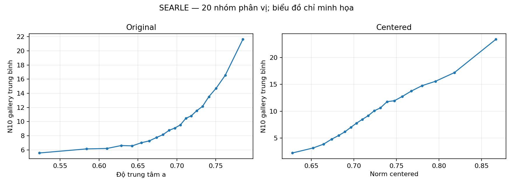
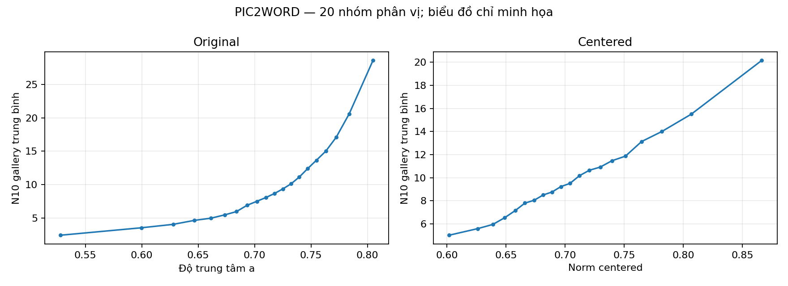

# D2 — Độ trung tâm, norm centered và N10 gallery

## 1. Câu hỏi và dự đoán

Dự đoán `ρ(a, N10_gallery_original)>0` và `ρ(||x−μ||, N10_gallery_centered)>0` cho từng backbone. Đây là phân tích R4 được đề xuất sau khi đã xem R3, không phải xác nhận độc lập. Xem [đăng ký](./dang_ky_truoc.md).

## 2. Thiết kế

CIRCO có 123.403 ảnh/model. N10 gallery đếm số ảnh khác chọn một ảnh vào top-10 exact IP; centered trừ mean khỏi cả query gallery và index, không chuẩn hóa lại, loại self theo ID. Tính Spearman midrank trên toàn gallery; CI percentile 95% từ 2.000 lần bootstrap ảnh, RNG 42. CI chỉ mô tả có điều kiện vì N10 phụ thuộc cùng gallery.

## 3. Kết quả

| Model | Tương quan | Spearman ρ | CI 95% mô tả | Đánh giá hướng dương |
|---|---|---:|---:|---|
| searle | a_vs_n10_original | +0.3499 | [+0.3451, +0.3549] | phù hợp hướng dương |
| searle | norm_vs_n10_centered | +0.4480 | [+0.4436, +0.4527] | phù hợp hướng dương |
| pic2word | a_vs_n10_original | +0.5396 | [+0.5354, +0.5436] | phù hợp hướng dương |
| pic2word | norm_vs_n10_centered | +0.3302 | [+0.3247, +0.3354] | phù hợp hướng dương |

### Phân phối N10 gallery

| Model | Biến thể | Skewness | N10 = 0 | Tỷ lệ N10 = 0 | Max |
|---|---|---:|---:|---:|---:|
| searle | before | 2.6590 | 10461 | 8.48% | 231 |
| searle | after | 4.6238 | 12229 | 9.91% | 468 |
| pic2word | before | 2.6593 | 13230 | 10.72% | 182 |
| pic2word | after | 3.4016 | 6919 | 5.61% | 225 |

## 4. Diễn giải

Mỗi dấu/CI được đánh giá riêng theo quy tắc đã ghi trước; tương quan không chứng minh độ trung tâm hoặc norm gây ra hubness. Tỷ lệ N10 bằng 0, skewness và chất lượng retrieval đo các khía cạnh khác nhau. N10 gallery khác bậc vào HNSW đo ở D1.

## 5. Giới hạn và provenance

Các ảnh không độc lập vì N10 tính từ cùng gallery; CI bootstrap chỉ mô tả có điều kiện và không đồng thời cho bốn phép. C4 không lưu toàn bộ danh sách neighbor theo hàng và không ghi hash riêng của payload N10 ở thời điểm tạo: D2 đối chiếu signature, progress, thống kê và 128 ảnh mẫu, nhưng không xác minh độc lập mọi lần loại self. Hash payload tại thời điểm D2 và snapshot code sạch được lưu trong manifest. Không diễn giải đây là xác nhận độc lập của giả thuyết đã được hình thành sau R3.

## 6. Tiếp theo

Đối chiếu với D1 và chạy D3 trước khi đánh giá tổng thể giả thuyết độ trung tâm.

[JSON](./results.json) · [manifest](./manifest.json) · [bảng tương quan](./spearman.csv).
