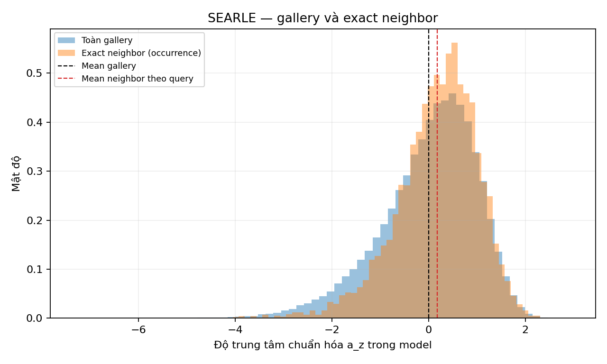
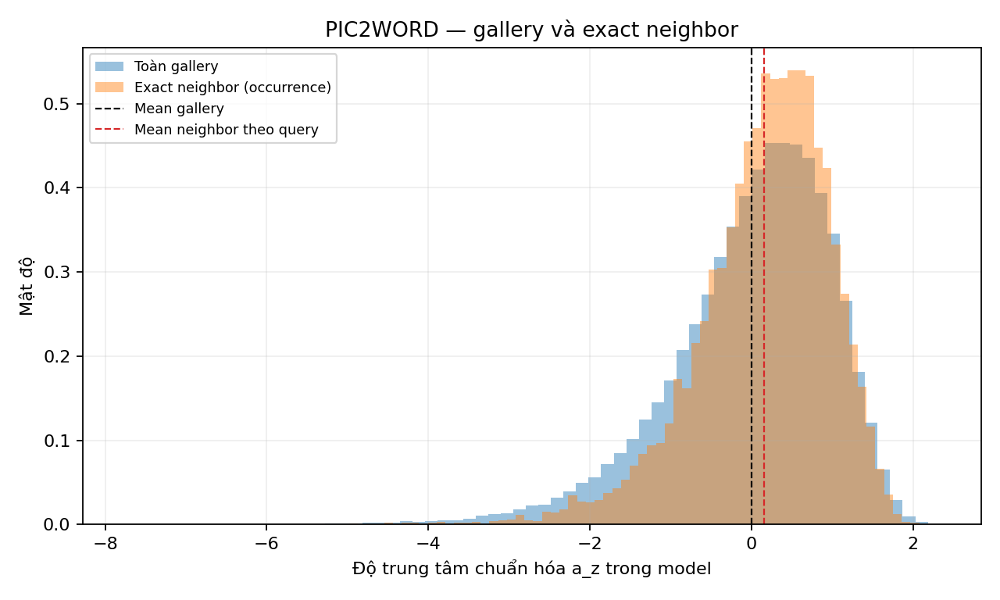

# D3 — Độ trung tâm của exact neighbor truy vấn CIR

## 1. Câu hỏi và dự đoán

Dự đoán exact neighbor CIR có `a_z` trung bình thấp hơn gallery trong từng model và Pic2Word lệch âm hơn SEARLE. Đây là phân tích R4 bổ sung sau khi biết kết quả R3; xem [đăng ký phân tích](./dang_ky_truoc.md).

## 2. Thiết kế

CIRCO: 123.403 ảnh gallery và 1.020 query/model. Với mỗi query lấy trung bình độ trung tâm chuẩn hóa trong model của 10 neighbor IP chính xác; so với trung bình toàn gallery. Bootstrap ghép cặp query giữa hai backbone 2.000 lần, cố định gallery và giữ đủ 10 neighbor/query; CI percentile 95%. Không xem các neighbor hoặc ảnh lặp là các query độc lập.

## 3. Kết quả từng model

| Model | Trung bình a_z neighbor theo query | Trung bình a_z gallery | Lệch | CI 95% | Số ảnh neighbor khác nhau |
|---|---:|---:|---:|---:|---:|
| searle | +0.1775 | +0.0000 | +0.1775 | [+0.1422, +0.2104] | 8327 |
| pic2word | +0.1527 | -0.0000 | +0.1527 | [+0.1212, +0.1814] | 8067 |

**searle:** không ủng hộ hướng âm. Phân vị 10/50/90 của các neighbor occurrence: -0.905, +0.271, +1.152; của trung bình theo query: -0.521, +0.259, +0.777. Trung bình theo ảnh neighbor duy nhất: +0.1594; 1302 ảnh xuất hiện nhiều hơn một lần, 10 ảnh xuất hiện nhiều nhất chiếm 0.87% occurrence.

Độ nhạy bỏ cả `test:251` và `test:631`: lệch +0.1765, CI [+0.1428, +0.2094], 1018 query.

**pic2word:** không ủng hộ hướng âm. Phân vị 10/50/90 của các neighbor occurrence: -0.899, +0.261, +1.087; của trung bình theo query: -0.418, +0.201, +0.690. Trung bình theo ảnh neighbor duy nhất: +0.1409; 1392 ảnh xuất hiện nhiều hơn một lần, 10 ảnh xuất hiện nhiều nhất chiếm 1.06% occurrence.

Độ nhạy bỏ cả `test:251` và `test:631`: lệch +0.1531, CI [+0.1219, +0.1815], 1018 query.

## 4. So sánh trực tiếp hai backbone

Δ = lệch Pic2Word − lệch SEARLE = **-0.0249**, CI ghép cặp [-0.0536, +0.0051]: chưa kết luận. Sau khi bỏ cả hai query trùng nội dung: Δ = -0.0235, CI [-0.0532, +0.0068]. CI được tính trực tiếp cho chênh lệch, không suy ra từ việc so hai CI riêng.

## 5. Hạn chế

Chuẩn hóa riêng từng backbone chỉ cho vị trí tương đối theo phân phối gallery của model, không tạo cùng thang hình học. Các query có thể chia sẻ ảnh neighbor; bootstrap query không giải quyết đầy đủ phụ thuộc theo ảnh. Tập test có hai ID khác nhau nhưng cùng reference/caption; độ nhạy loại cả hai được báo riêng, kết quả chính giữ tập chính thức. Cache cũ không ghi source ID từng hàng; Bước 0 hỗ trợ tính nhất quán theo vị trí nhưng không chứng minh lịch sử ID tuyệt đối. CI theo từng phép không phải CI đồng thời.

D3 dựa trên query CIR, chưa so với query ảnh; liên hệ này không chứng minh độ trung tâm gây ra gain centering hay là yếu tố duy nhất khác biệt giữa backbone. Thiết kế được đề xuất sau khi biết kết quả R3, không phải xác nhận độc lập.

## 6. Tiếp theo

Kết hợp D1–D3, sau đó thiết kế đối chứng query ảnh và kiểm tra chi phí/mật độ theo kế hoạch R4.

[JSON kết quả](./results.json) · [manifest](./manifest.json) · [bảng từng query](./data/per_query.csv).
